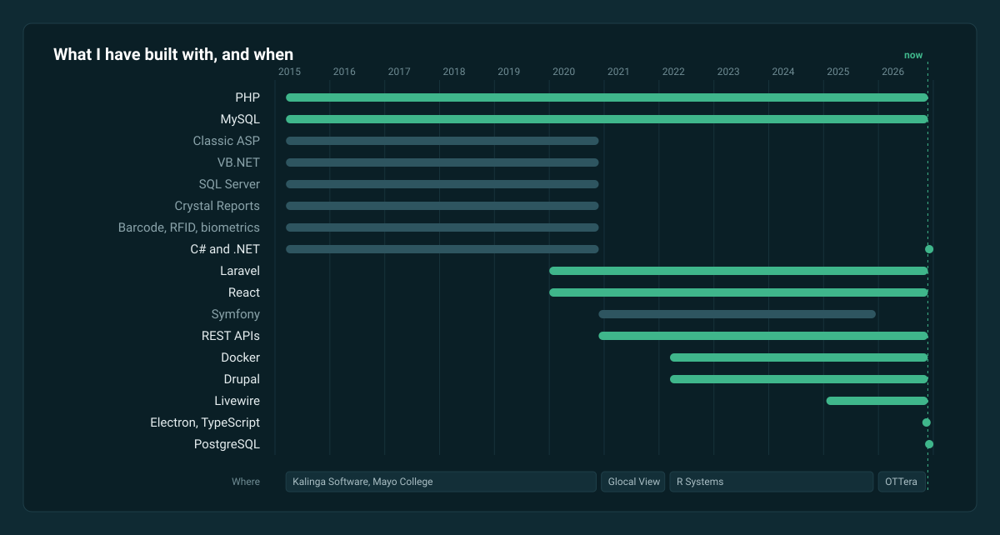
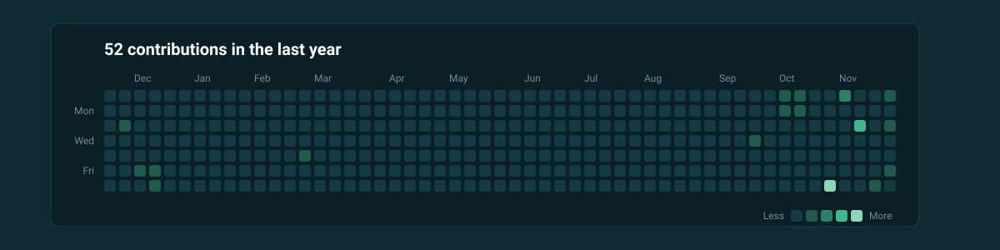

  
  
  
  

I build the systems small businesses and institutions run their money and records on: a cooperative's loan book, a repair shop's till, a group of schools' admissions office. Most of it is client work in private repos, so this page is the summary.

## How I build

- **Money is `decimal`, never `float`.** Rounding errors in a ledger are bugs, not noise.
- **Every posting leaves an audit trail.** Who changed what, and when, is part of the feature.
- **Tenants and roles are enforced on the server.** Hiding a button is not access control.
- **Tests run against a real database.** Mocks don't catch a bad migration.
- **A shop counter has no reliable internet.** If the business stops when Wi-Fi does, the software failed.

## Stack

Also in the toolbox: `Git` `Node.js` `CodeIgniter` `WordPress` `jQuery` `Angular` `Bootstrap` `Chart.js` `SQLite` `MS Access` `PHPUnit` `Vitest` `Playwright`

## Selected work

| Project | Who it's for | Built with |
|---|---|---|
| **Mini-Banking** | A savings and credit cooperative: members, shares, loans, vouchers, CSV import | `Laravel 13` `MySQL` |
| **eIMS** | Groups of schools: admissions, student records, role-based staff access | `.NET` `React` `PostgreSQL` `Docker` |
| **ShopBahi** | A mobile repair shop: barcode billing, IMEI stock, party ledgers, cash book, fully offline | `Electron` `React` `TypeScript` `SQLite` |
| **iPBX Admin Portal** | A school phone network: prepaid call wallets, call reports, multi-tenant admin | `Laravel` `MySQL` `Asterisk` |
| **GatePass** | Front gates: QR guest passes, scanner, SMS reminders, entry logs | `Laravel` `Livewire` `MySQL` |
| **Polkaji Infotech** | An EdTech company's website and its Smart Student Dialer | `Blade` `CSS` `JavaScript` |
| [princeshakya.com](https://princeshakya.com) | Me | `HTML` `CSS` |

## Get in touch

Building something that has to balance at the end of the day? Email [prince.shakya010@gmail.com](mailto:prince.shakya010@gmail.com), or open [princeshakya.com](https://princeshakya.com): it's laid out like an office register, with my work, experience and [résumé](https://princeshakya.com/resume.pdf).
